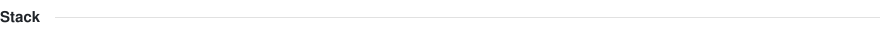
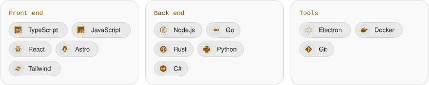
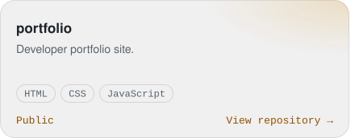
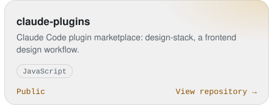
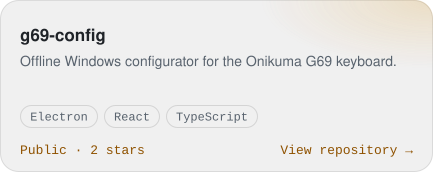
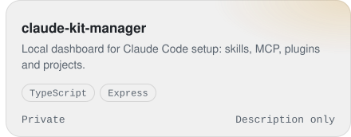
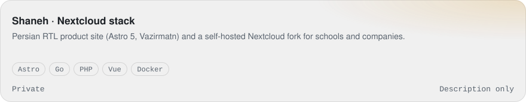
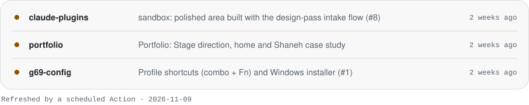

<picture><source media="(prefers-color-scheme: dark)" srcset="assets/hero-dark.svg"></picture>

<a href="https://t.me/ssizy"><picture><source media="(prefers-color-scheme: dark)" srcset="assets/btn-telegram-dark.svg"></picture></a>
<a href="mailto:hossein85salehi@gmail.com"><picture><source media="(prefers-color-scheme: dark)" srcset="assets/btn-email-dark.svg"></picture></a>
<a href="https://www.linkedin.com/in/hossein-salehi-b94759303/"><picture><source media="(prefers-color-scheme: dark)" srcset="assets/btn-linkedin-dark.svg"></picture></a>
<a href="https://ssizyyy.github.io/portfolio/"><picture><source media="(prefers-color-scheme: dark)" srcset="assets/btn-portfolio-dark.svg"></picture></a>

<picture><source media="(prefers-color-scheme: dark)" srcset="assets/h-stack-dark.svg"></picture>

<picture><source media="(prefers-color-scheme: dark)" srcset="assets/stack-dark.svg"></picture>

<picture><source media="(prefers-color-scheme: dark)" srcset="assets/h-featured-dark.svg"></picture>

<a href="https://github.com/Ssizyyy/portfolio"><picture><source media="(prefers-color-scheme: dark)" srcset="assets/card-portfolio-dark.svg"></picture></a><a href="https://github.com/Ssizyyy/claude-plugins"><picture><source media="(prefers-color-scheme: dark)" srcset="assets/card-claude-plugins-dark.svg"></picture></a>

<a href="https://github.com/Ssizyyy/g69-config"><picture><source media="(prefers-color-scheme: dark)" srcset="assets/card-g69-config-dark.svg"></picture></a><picture><source media="(prefers-color-scheme: dark)" srcset="assets/card-claude-kit-manager-dark.svg"></picture>

<picture><source media="(prefers-color-scheme: dark)" srcset="assets/card-shaneh-dark.svg"></picture>

<picture><source media="(prefers-color-scheme: dark)" srcset="assets/h-currently-dark.svg"></picture>

<picture><source media="(prefers-color-scheme: dark)" srcset="assets/building-dark.svg"></picture>

© Hossein Salehi · built with SVG, no widgets

